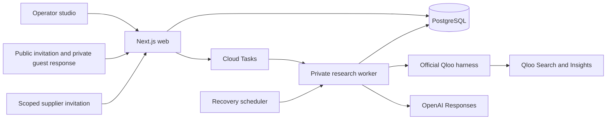

# Architecture

ASSEMBLY connects cultural discovery to an event that people can explicitly approve, help produce and choose to attend. Its agent proposes creative compositions. Application code controls publication, supplier commitments, guest consent and allocation.

## Product state and authority

An operator has a browser-scoped private session with a list of productions. Each production has its own identity, terms, inventory, event lifecycle and audit records. Rehearsal workspaces use fictional inventory and expire after 24 hours. Own-production workspaces start with blank inventory, last 90 days, and support free reservations. Neither mode verifies a person's legal identity or sends messages.

Every owner mutation carries a workspace identity, expected version and idempotency key. PostgreSQL locks the workspace, validates the command and commits the new document and replay record together. A stale tab cannot accidentally apply its event command to the newly selected production.

Public invitation records omit private operator and attendee data. Guests receive a random private response capability; suppliers receive a capability scoped to one offer. These capabilities do not grant owner authority. The database stores capability hashes. Possession authorizes the corresponding response; this is not email verification, proof of a unique human, or an electronic signature.

Publication and greenlight require explicit operator decisions about the current terms. Supplier acceptance binds the current offer and event terms. Free reservation requests serialize against the event's app-managed allotment, so concurrent requests cannot over-allocate its final place. This does not reserve inventory in an external ticketing system.

Live and own-production schedules use explicit offer program and setup times. Scope prose is not parsed into a supposed agreement, and activities are not silently placed at doors-open. The application checks program bounds, setup completion and overlaps; concurrent service requires an explicit operator choice. Exact program slots belong to the reviewed terms and supplier confirmation. Reading an older approved production never silently replaces its terms or schedule.

Saving a material-change proposal immediately pauses reservations and records the proposed diff without applying the revised terms. Approval changes the terms version and marks affected guests for reconfirmation. Held allocations remain held until the guest accepts the revision or withdraws. Replacement supply, room capacity, sound, schedule and full-capacity costs are checked before recovery. Cancellation releases allocations. Recorded interest, current consent, reservations, check-ins, operator completion assertions and guest feedback remain separate facts.

## Research and provenance

Catalog search returns at most five canonical candidates for explicit operator selection. Entering a familiar name in the brief does not establish an entity match. Offer-to-influence mappings are also explicit: they describe an editorial relationship between local inventory and a known cultural entity, not a Qloo score for the supplier.

A durable research snapshot contains the saved brief, numeric venue constraints, inventory and confirmed identities. Before sending model inputs, the worker constructs another allowlist that excludes supplier names and scopes, addresses, contacts, tokens, bookings and commitments. Obvious contact details in abstract free text are redacted. Credentials never enter prompts.

The AI SDK 7 `ToolLoopAgent` uses OpenAI Responses with `gpt-6.1-sol`. Its enforced loop invokes three tool stages: inspect inventory, discover cultural options in two or three enabled categories, and propose exactly three structured formats. Application code checks deterministic feasibility during proposal validation. The agent has no publish, book, message, payment or approval tool.

The official Qloo harness 0.1.26 executes fixed Search or Insights commands. Each subprocess allows one GET to the configured hackathon API, forbids redirects and retries, and limits time and response size. Returned entity type, identity and candidate membership are validated. Missing candidates retain no invented rank or score. Scores remain category-specific; they are never combined into attendance probability.

Proposal tools accept exact inventory IDs and exact entity/evidence references, plus labelled creative titles and rationale. Application code assembles factual descriptions, supplier names, ingredients and costs from the supplied records. Unknown fields, invented citations, unsupported operational claims and infeasible combinations are rejected. Operational availability and rights remain unresolved until people record the required confirmations.

Evidence records retain the category, capture time, query fingerprint, source, returned ranks and interpretation boundary. Fresh cache reuse is visible. A failed live request does not fall back to an authored concept. Authored examples and live evidence can coexist in a rehearsal, with their different origins preserved.

## Durability and spending controls

The database stores versioned JSONB workspace documents and ten relational tables for ownership, capabilities, idempotency, jobs, rates, provider budgets, caches and worker health. Schema changes run through an explicit migration command under a separate identity.

Workers claim durable jobs with `FOR UPDATE SKIP LOCKED`, a lease token and bounded attempts. Every provider reservation, checkpoint and completion verifies the current lease and input fingerprint. Cancellation, changed inputs and reset prevent late results from applying. Cloud Tasks redelivery and scheduled recovery use the same fencing.

Provider allowance is reserved transactionally before the request. A search permits one Qloo call. A research job permits at most six Qloo calls and four model steps, including at most one proposal-repair step; its total deadline is 90 seconds. Persisted daily limits additionally bound global and workspace use. These are application call limits, not a measurement of the hackathon key's remaining credit or a dollar spending cap.

Before queuing composition, a deterministic preflight requires at least two individually workable offers, matching the proposal rule that the three formats use at least two different inventory combinations. It identifies missing timing, expired or unavailable offers, excessive cost and sound conflicts before changing the run or its budget. Additional incomplete alternatives may remain in the inventory; the selected combination still needs full feasibility and approval.

## Hosting and privacy

The Google Cloud deployment separates a public web service from an IAM-protected worker. Only the worker receives provider keys. Cloud Tasks and Scheduler use a dedicated OIDC invoker. Cloud SQL has a private IP, encrypted connections and backups; runtime database credentials have application-data permissions and no schema or role administration.

The direct database connection verifies its exact per-instance Cloud SQL certificate authority. The explicit `verify-ca` mode retains certificate-chain verification and is appropriate only for that unique per-instance CA. Other databases default to hostname verification. Deployment smoke checks require an unrelated CA to fail.

Capability routes use `no-referrer`, private/no-store responses and no indexing. The deployment excludes those route URLs from the default Cloud Run request-log sink. No custom tracing is enabled. Do not introduce logs or analytics that record private capabilities, prompts or provider payloads.

Health distinguishes a reachable database from a recently observed worker. Configuration alone is not evidence that the worker has run. A recent heartbeat is process evidence, not a guarantee that the next paid provider request will succeed.

See [deployment instructions](deploy/gcp/README.md) for service limits, pinned secrets, release order and recovery. See [README](README.md) for the supported scope and reproducible setup.
